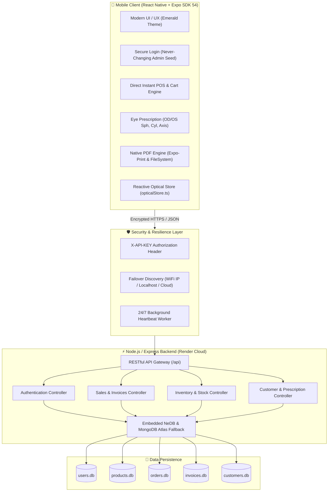

# 👓 Shree Ganesh Optical POS & Inventory Management System

> **Enterprise Mobile & Cloud Point of Sale (POS), CRM, Optical Rx Engine, and Inventory ERP designed for Optical Showrooms & Eyewear Retailers.**

---

## 🌟 Executive Overview

**Shree Ganesh Optical POS** is a mobile-first Point of Sale and Inventory Management application coupled with a high-performance Node.js / Express backend. Built specifically for modern eyewear businesses, opticians, and optical retail chains, it provides end-to-end management of eye prescriptions, spectacle frames, progressive/bifocal lenses, customer visual history, multi-mode billing, and professional PDF cash memo generation with native WhatsApp sharing.

---

## 📐 System Architecture & Design



---

## 🚀 Key Features & Capabilities

### 1. ⚡ Instant Direct Sale & Quick POS
- **Unified Quick Sale Card**: Create spot optical sales in seconds without heavy navigation.
- **Dynamic Price & Quantity Engine**: Live calculation of totals, itemized advances, and balance due.
- **Pre-populated Optical Presets**: Single-touch selection for frames, progressive lenses, blue-cut coatings, and reading glasses.
- **Multiple Payment Modes**: Cash, UPI / PhonePe / GooglePay, Credit/Debit Card, and Split/Credit.

### 2. 👁️ Optical Prescription & Eye Examination Engine
- Full **O.D. (Right Eye)** and **O.S. (Left Eye)** measurement tracking:
  - **Spherical (SPH)**
  - **Cylindrical (CYL)**
  - **Axis (0° - 180°)**
  - **Near Addition (ADD)**
  - **Pupillary Distance (PD)**
- **Lens Type Categorization**: Single Vision, Bifocal (Kryptok / D-segment), Progressive, Anti-glare (ARC), Blue-blocker, and Photochromic.

### 3. 🧾 Professional Optical Cash Memo & Native PDF Sharing
- **Official Bill Receipts**: Formatted specifically for retail eyewear stores with bilingual headings (Hindi & English).
- **Direct PDF Generation**: Generated on-device using vector layout rendering without quality loss.
- **Native Android / iOS Share Sheet**: 1-tap sharing to WhatsApp, Gmail, Telegram, and Wireless Thermal Bluetooth Printers.
- **Customized WhatsApp Bill Template**: Pre-formatted WhatsApp message with customer name, item details, bill number, advance, and due balance.

### 4. 📊 Live Dynamic Sales Analytics & Rolling Metrics
- **Real-time Metrics**: Live calculation of **Today**, **This Week**, and **This Month** revenue directly from persistent invoices.
- **Rolling 7-Day Sales Bar Chart**: Visual revenue breakdown showing daily fluctuations, total sales volume, and order counts.
- **Due Checkup Tracking**: Proactive customer filter showing which customers are due for their annual eye examination.

### 5. 👥 Customer Relationship Management (CRM)
- Customer purchase history and lifetime optical value tracking.
- Stored vision prescription logs over time to observe eyesight progression.
- Rapid contact actions: WhatsApp direct chat, 1-touch telephone calling, and address navigation.

### 6. 🔐 Hardened Backend Authentication & Database Seeding
- **Centralized Security**: Frontend hardcoding completely eliminated.
- **Seeded Permanent Credentials**:
  - **Admin Email**: `ankit@ganeshoptical.com`
  - **Default Password**: `Gnesh_optical`
- **Zero-Downtime Keep-Alive Engine**: Self-pinging background daemon prevents cloud hosting (Render) from going into cold-sleep mode.

---

## 🎨 Design System & UI Principles

- **Primary Accent**: Deep Emerald Green (`#04281B`, `#0A3925`, `#059669`) symbolizing clear sight, trust, and optical elegance.
- **Typography**: Crisp Devanagari & Latin hybrid font stack with strict readability on AMOLED and IPS screens.
- **Card-Driven Architecture**: High elevation, smooth rounded corners (`16px - 24px`), and spacious touch targets tailored for shop counters and tablet/phone operation.

---

## 🛠️ Technology Stack

| Layer | Technologies |
|---|---|
| **Mobile Frontend** | React Native, Expo SDK 54, Expo Router, TypeScript |
| **Icons & Media** | Lucide React Native, React Native SVG, Custom Vector Glasses Logo |
| **PDF & Printing** | Expo Print, Expo Sharing, Expo FileSystem |
| **Backend Server** | Node.js, Express.js, TypeScript |
| **Database** | Embedded NeDB (Zero-dependency local persistence) + MongoDB Atlas driver |
| **Deployment** | Render Cloud, EAS Build (Android APK / AAB) |

---

## 📦 Project Structure

```text
├── .gitignore                   # Master Git ignore rules
├── backend/                     # Node.js Express API Server
│   ├── src/
│   │   ├── controllers/         # Auth, Product, Customer, Order & Invoice controllers
│   │   ├── middleware/          # API Key security & validation
│   │   ├── models/              # Schema definitions
│   │   ├── routes/              # Express API routing (/api)
│   │   ├── db.ts                # NeDB & MongoDB connector
│   │   ├── seed.ts              # Guaranteed admin user seeder
│   │   └── server.ts            # Entrypoint & 24/7 keep-alive worker
│   └── package.json
└── mobile/                      # Expo React Native Mobile App
    ├── app/                     # Expo Router file-based screens
    │   ├── (auth)/              # Login and authentication screens
    │   ├── (tabs)/              # Dashboard, POS, Products, Orders, Invoices, Customers
    │   ├── checkout/            # Cart checkout & payment confirmation
    │   ├── customers/           # Add/View customer & Rx logs
    │   └── invoices/            # Printable Cash Memo & full preview
    ├── assets/                  # Brand images, backgrounds & icons
    ├── src/
    │   ├── components/          # Modular UI components
    │   ├── services/            # apiService.ts & pdfService.ts
    │   ├── store/               # opticalStore.ts (Reactive live state)
    │   └── types/               # TypeScript domain interfaces
    └── app.json                 # Expo project configuration
```

---

## ⚡ Quick Start & Development Setup

### 1. Prerequisites
- Node.js (v18 or higher)
- npm or yarn
- Expo Go App (on your Android / iOS device)

### 2. Backend Setup
```bash
cd backend
npm install
npm run build
npm start
```
*Backend will start on `http://localhost:5000` (Health check at `/api/health`).*

### 3. Mobile Setup
```bash
cd ../mobile
npm install
npx expo start
```
*Scan the QR code with your phone camera (iOS) or Expo Go App (Android).*

---

## 👨‍💼 Authorized Store Info

- **Store Name**: श्री गणेश ऑप्टिकल (Shree Ganesh Optical)
- **Location**: ASG Eye Hospital के पास, इंग्लिशपुरा, सीहोर (म.प्र.) - 466001
- **Contact**: +91 6263732857
- **Authorized Person**: अंकित वर्मा (Ankit Verma)

---

## 📄 License
This software is developed exclusively for **Shree Ganesh Optical, Sehore**. All rights reserved.

---
 ## Developed and Maintained by Madhaw Verma ❤️💖
